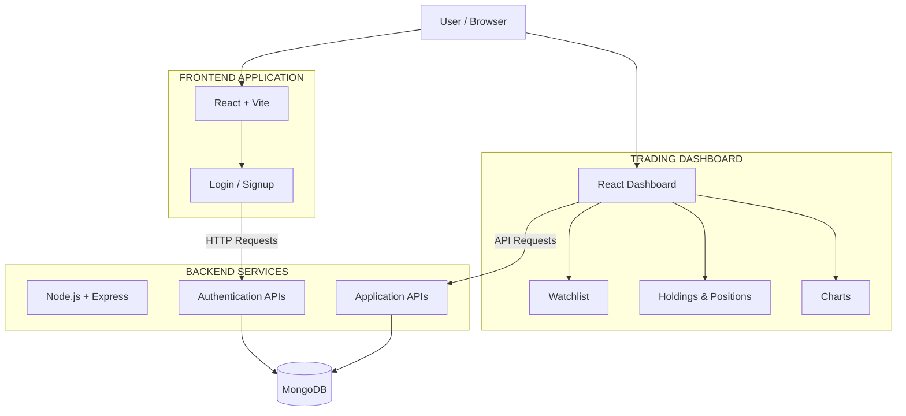

# Zerodha Clone

<p align="center">
  <strong>INVEST SMARTER. TRACK BETTER. TRADE WITH CONFIDENCE.</strong>
</p>

<p align="center">
  A full-stack stock trading platform inspired by Zerodha, featuring an interactive dashboard, portfolio tracking, watchlists, authentication, and stock management.
</p>

<p align="center">
  <a href="https://zerodha-clone-by69.vercel.app/">
    
  </a>
  <a href="https://github.com/Harshit-Webworld1515/zerodha-clone">
    
  </a>
</p>

---

<p align="center">
  
  
  
  
</p>

<p align="center">
  <a href="#-overview">Overview</a> •
  <a href="#-features">Features</a> •
  <a href="#-screenshots">Screenshots</a> •
  <a href="#-architecture">Architecture</a> •
  <a href="#-installation">Installation</a> •
  <a href="#-roadmap">Roadmap</a>
</p>

---

## 01 — Overview

Zerodha Clone is a full-stack stock trading platform developed to recreate the core experience of a modern online trading application.

The application consists of a frontend website, a dedicated trading dashboard, and a backend API connected to MongoDB.

It provides an interactive interface for authentication, viewing stock watchlists, monitoring holdings and positions, and visualizing portfolio-related information.

The project focuses on building a complete full-stack application with separate frontend and dashboard applications communicating with a centralized backend.

### The core idea

**React powers the experience. Node.js handles the backend. MongoDB stores the data.**

---

## 02 — Features

| Capability | Description |
|---|---|
| 🔐 User Authentication | Registration and login functionality |
| 🍪 Cookie-Based Authentication | Uses HTTP-only cookies for authentication |
| 📊 Interactive Dashboard | Dedicated dashboard for portfolio monitoring |
| 📈 Holdings | Displays stock holdings and related information |
| 📉 Positions | Shows position details and profit/loss information |
| 👀 Watchlist | Displays stocks and their market-related details |
| 📊 Data Visualization | Graphs and charts for portfolio-related data |
| 🧭 Navigation | Separate dashboard sections and navigation |
| 🔗 Frontend Integration | Connects frontend and dashboard with backend APIs |
| ☁️ Cloud Deployment | Deployed frontend, dashboard, and backend |

---

## 03 — Technology Stack

<p align="center">
  
</p>

| Layer | Technologies |
|---|---|
| Frontend | React.js, JavaScript, Vite |
| Dashboard | React.js, Create React App |
| Styling | HTML5, CSS3, Bootstrap |
| UI Components | Material UI |
| Routing | React Router |
| API Requests | Axios, Fetch API |
| Backend | Node.js, Express.js |
| Database | MongoDB, Mongoose |
| Authentication | JWT, HTTP-only Cookies |
| Charts | Chart.js |
| Deployment | Vercel, Render |
| Version Control | Git, GitHub |

---

## 04 — Live Application

| Application | Link |
|---|---|
| Main Website | [Open Website](https://zerodha-clone-by69.vercel.app/) |
| Trading Dashboard | [Open Dashboard](https://zerodha-clone-tl2i-eight.vercel.app/) |
| Backend API | [Backend Server](https://zerodha-clone-backend-2mr0.onrender.com/) |
| GitHub Repository | [View Source Code](https://github.com/Harshit-Webworld1515/zerodha-clone) |

---

## 05 — Screenshots

Screenshots below showcase the major sections of the application.

<!-- Replace these paths with your actual screenshot filenames after uploading them to the repository. -->

### Landing Page

<p align="center">
  
</p>

### Authentication

<p align="center">
  
  &nbsp;
  
</p>

### Dashboard

<p align="center">
  
</p>

### Holdings & Positions

<p align="center">
  
</p>

<p align="center">
  
</p>

### Watchlist

<p align="center">
  
</p>

---

## 06 — Architecture

The application follows a multi-application architecture with separate frontend, dashboard, and backend services.



### Architecture at a glance

- **Frontend:** Provides the main website and authentication interface.
- **Dashboard:** Handles watchlists, holdings, positions, and portfolio visualization.
- **Express:** Handles backend routes and API requests.
- **Node.js:** Runs the backend application.
- **MongoDB:** Stores application data.
- **JWT & Cookies:** Support authentication and protected access.

---

## 07 — Project Structure

```text
zerodha-clone/
│
├── frontend/
│   ├── public/
│   ├── src/
│   │   ├── components/
│   │   ├── landing_page/
│   │   ├── ...
│   │   └── main.jsx
│   └── package.json
│
├── dashboard/
│   ├── public/
│   ├── src/
│   │   ├── components/
│   │   ├── data/
│   │   └── index.js
│   └── package.json
│
├── backend/
│   ├── Controllers/
│   ├── Models/
│   ├── Routes/
│   ├── ...
│   └── package.json
│
├── .gitignore
└── README.md
```

The structure highlights the major application directories. Additional files and modules are present in the repository.

---

## 08 — Installation & Setup

### Prerequisites

- Node.js and npm
- Git
- MongoDB or MongoDB Atlas
- Code editor (VS Code recommended)

### Step 1 — Clone the repository

```bash
git clone https://github.com/Harshit-Webworld1515/zerodha-clone.git

cd zerodha-clone
```

### Step 2 — Setup Backend

```bash
cd backend
npm install
```

Create a `.env` file in the backend directory and configure the environment variables required by the backend.

```env
PORT=5000
MONGO_URL=your_mongodb_connection_string
JWT_SECRET=your_jwt_secret
```

Use the exact environment variable names expected by your backend source code.

### Step 3 — Start Backend

```bash
npm start
```

If your backend uses a different development script, use the corresponding command from `backend/package.json`.

### Step 4 — Setup Frontend

Open another terminal:

```bash
cd frontend
npm install
npm run dev
```

### Step 5 — Setup Dashboard

Open another terminal:

```bash
cd dashboard
npm install
npm start
```

### Step 6 — Open the Application

Open the local URLs printed by the frontend and dashboard development servers.

Make sure the backend is running and the frontend/dashboard API configuration points to the correct backend URL.

---

## 09 — Engineering Challenges

### Authentication & Protected Routes

Implementing registration, login, JWT-based authentication, HTTP-only cookies, and protected dashboard access.

### Frontend–Backend Integration

Connecting multiple React applications to a centralized Express backend and handling API requests.

### Cookie Configuration

Handling cross-origin authentication cookies between separately deployed frontend, dashboard, and backend applications.

### Dashboard Data Management

Fetching and displaying holdings, positions, and watchlist information through backend APIs.

### Data Visualization

Transforming fetched stock data into datasets suitable for graphical representation.

### Deployment

Deploying separate frontend, dashboard, and backend applications using Vercel and Render.

---

## 10 — Current Limitations

- The interface is currently optimized primarily for desktop screens.
- The application is an educational project, not a real brokerage platform.
- Stock data and trading functionality should not be considered real-time market services.
- Production-grade financial integrations and security audits are outside the current scope.

---

## 11 — Roadmap

- [ ] Improve mobile and tablet responsiveness
- [ ] Enhance dashboard data visualization
- [ ] Add more advanced portfolio analytics
- [ ] Improve API error handling and loading states
- [ ] Add automated frontend and backend tests
- [ ] Strengthen production security
- [ ] Improve overall dashboard user experience

These items represent possible future improvements.

---

## 12 — Key Learning Outcomes

Building this project provided practical experience with:

- Full-stack application development using React and Node.js
- Building REST APIs using Express.js
- MongoDB integration with Mongoose
- JWT authentication and HTTP-only cookies
- Protected routes and React Router
- Fetching and managing data using React Hooks
- Creating interactive dashboards and charts
- Cross-origin requests and CORS configuration
- Deploying full-stack applications using Vercel and Render
- Git and GitHub version control workflows

---

## Disclaimer

This project is created for educational and demonstration purposes only. It is inspired by Zerodha but is not affiliated with, endorsed by, or connected to Zerodha.

It does not provide real brokerage services, financial advice, or actual stock market trading.

---

## Author

**Harshit Pandit**

- GitHub: [@Harshit-Webworld1515](https://github.com/Harshit-Webworld1515)
- Project: [Zerodha Clone](https://github.com/Harshit-Webworld1515/zerodha-clone)

---

<p align="center">
  <strong>ZERODHA CLONE</strong>
  <br/>
  <sub>Built with React, Node.js, and a passion for full-stack development.</sub>
</p>
